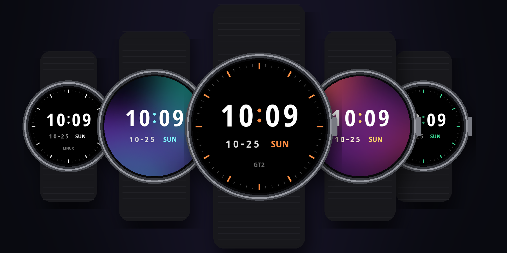
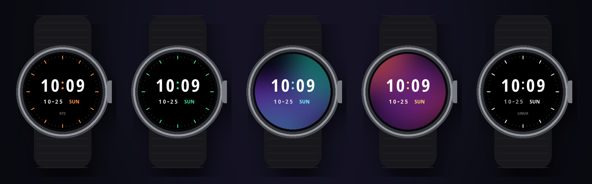
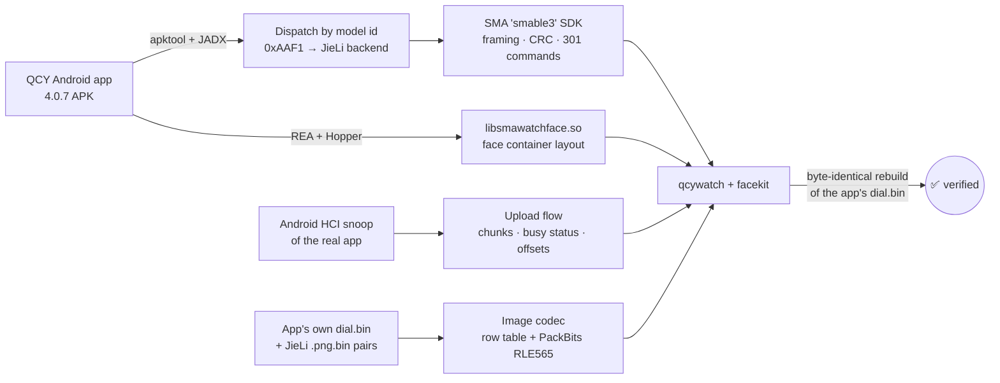

<div align="center">

# ⌚ qcywatch

### Custom watch faces and full control for the **QCY Watch GT2**, from Linux. No phone app, no cloud, no account.

[](https://github.com/DhrubaDC1/qcywatch/actions/workflows/selftest.yml)


[](LICENSE)



**Design a face in one command, install it over Bluetooth in ~30 seconds.**
Every byte of the protocol and file format was reverse engineered, then verified against the official app's own output.

</div>

---

## ✨ What it does

|   | |
|---|---|
| 🎨 **Make watch faces** | Your colours, your photo, your text. Rendered to the watch's real image format. |
| 📡 **Install them over BLE** | Streams the face straight to the watch. No QCY app involved. |
| 🔋 **Control the watch** | Read battery & firmware, sync time, make it buzz, push notifications from your PC. |
| 🤖 **Let an AI do it** | Ships as a [Claude Code](https://claude.com/claude-code) skill: *"make me a teal face with my cat on it"* → done. |
| 🔬 **Documented protocol** | Framing, CRC, commands, upload flow, file and image formats: [reference.md](reference.md). |

## 🚀 Quick start

```bash
git clone https://github.com/DhrubaDC1/qcywatch ~/.claude/skills/qcy-watchface   # or anywhere you like
cd ~/.claude/skills/qcy-watchface

scripts/makeface.py out --accent '#3ddc97'            # 1. design   → out/face.bin + out/face_full.png
scripts/qcywatch face out/face.bin                    # 2. install  (turn your phone's Bluetooth off first)
```

```text
$ scripts/qcywatch face out/face.bin
upload 100%
face installed
```

The scripts are self-contained [uv](https://docs.astral.sh/uv/) scripts: dependencies (`bleak`, `pillow`) install themselves on first run.

<details>
<summary><b>One-time Linux setup</b> (recent BlueZ; tested on 5.87)</summary>

The GT2 is dual-mode (Classic + LE). Its control channel lives on LE only, so BlueZ must be allowed to pick the LE bearer:

```bash
sudo sed -i 's/^#\?Experimental = false/Experimental = true/' /etc/bluetooth/main.conf
sudo systemctl restart bluetooth
```

The watch accepts **one** connection at a time, so switch your phone's Bluetooth off while using qcywatch. Turn it back on afterwards and the QCY app reconnects as usual.
</details>

## 🎨 Make your own face



```bash
scripts/makeface.py out                                              # Ember (default)
scripts/makeface.py out --accent '#3ddc97' --label ''                # Mint
scripts/makeface.py out --bg-image ~/Pictures/me.jpg --dim 0.5       # your photo
scripts/makeface.py out --accent '#e8e8e8' --date-color '#9a9a9a' --label LINUX
```

| Option | Default | |
|---|---|---|
| `--accent` | `#ff8c42` | colon, hour ticks, weekday |
| `--time-color` / `--date-color` | white / light grey | digits |
| `--bg-image` / `--dim` | none / `0.45` | photo background, brightness factor |
| `--label` | `GT2` | small text under the date (`''` for none) |
| `--no-ticks` | | hide the minute ring |
| `--font` / `--font-med` | Noto Sans Condensed Bold | any `.ttf`; falls back to `fc-match` |

Want a completely different layout? [`scripts/facekit.py`](scripts/facekit.py) is a small library: place a background, then digit sets for hour, minute, month, day and weekday wherever you like, and `facekit.build()` writes a valid file. `facekit.py check face.bin` decodes every image before you upload.

## 📡 Control the watch

```bash
scripts/qcywatch info                          # name / platform / model / firmware
scripts/qcywatch battery                       # battery: 87%
scripts/qcywatch time                          # sync clock + time zone from the PC
scripts/qcywatch find                          # make it buzz
scripts/qcywatch notify "Build" "CI passed ✅"  # pop a notification
```

Wire it into anything: `make && qcywatch notify Build done`, a cron job that syncs the time, a hook that buzzes your wrist when a long job finishes.

## 🤖 Use it from an AI agent

This repo **is** a Claude Code skill (`SKILL.md`). Clone it into `~/.claude/skills/` and ask:

> *"Make a watch face with a sunset gradient and yellow accents and put it on my watch."*

The agent designs the face, looks at the rendered preview, fixes contrast or overlaps, validates the file, uploads it, and asks you to confirm on your wrist. The workflow and its safety rules are in [SKILL.md](SKILL.md).

## 🔬 How it was reverse engineered



1. **Which code talks to the GT2?** The app bundles five watch SDKs. It picks one with `modelId & 0xF000` from the BLE advertisement. The GT2 advertises `0xAAF1` (internal name "S3"), which routes to the JieLi backend. That backend turned out to speak the SMA `smable3` protocol over Nordic UART.
2. **The protocol.** `AB | flags | len | CRC-16/ARC | cmd | key | action | data`, stop-and-wait with replies. Confirmed against 1,500+ captured frames with zero CRC errors.
3. **The face file.** The container builder is a 14 KB native library. Its layout was recovered with [REA](https://github.com/morluto/rea), then corrected against a real `dial.bin` pulled from the phone.
4. **The pixels.** JieLi's converter turned out to be a per-row offset table plus PackBits RLE over big-endian RGB565 (or alpha + RGB565). The encoder here reproduces all 40 of the app's converted images **byte for byte**, and rebuilds the app's whole `dial.bin` identically.

Full details: [reference.md](reference.md).

## 🧭 Compatibility

| Device | Status |
|---|---|
| QCY Watch GT2 (S3, firmware S3_V023) | ✅ Tested: faces, info, battery, time, find, notify |
| Other QCY watches using the JieLi backend (e.g. S5) | ❓ Likely similar; screen size may differ |
| Other watches built on the SMA `smable3` SDK | ❓ Same protocol family; face format may differ |

Got another watch working (or not)? **Open an issue with your `qcywatch info` output.** That's the fastest way to grow this list.

## 🗺️ Roadmap

- [ ] Analog faces (hour/minute/second hands are in the format, untested)
- [ ] Steps / heart-rate / battery complications
- [ ] Web face designer with live preview
- [ ] Weather push, music control
- [ ] macOS / Windows (bleak supports them; the LE-bearer trick is BlueZ-specific)

PRs welcome. Run `scripts/qcywatch selftest` and `scripts/facekit.py selftest` before sending one.

## ⚠️ Disclaimer

Independent interoperability project. **Not affiliated with or endorsed by QCY.** "QCY" is used only to say which device this works with. You use it at your own risk: a broken face file could misbehave on the watch, which is why `facekit check` runs before every upload. MIT licensed.

<div align="center">

**If this freed your watch, a ⭐ helps others find it.**

</div>
